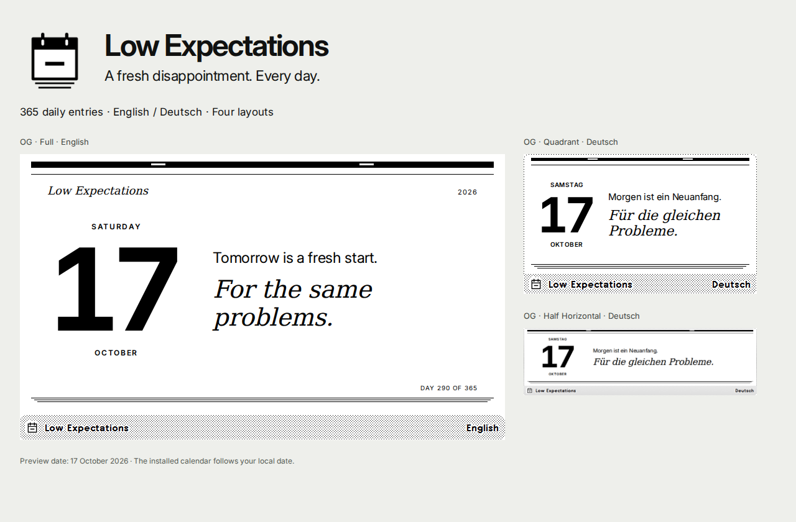
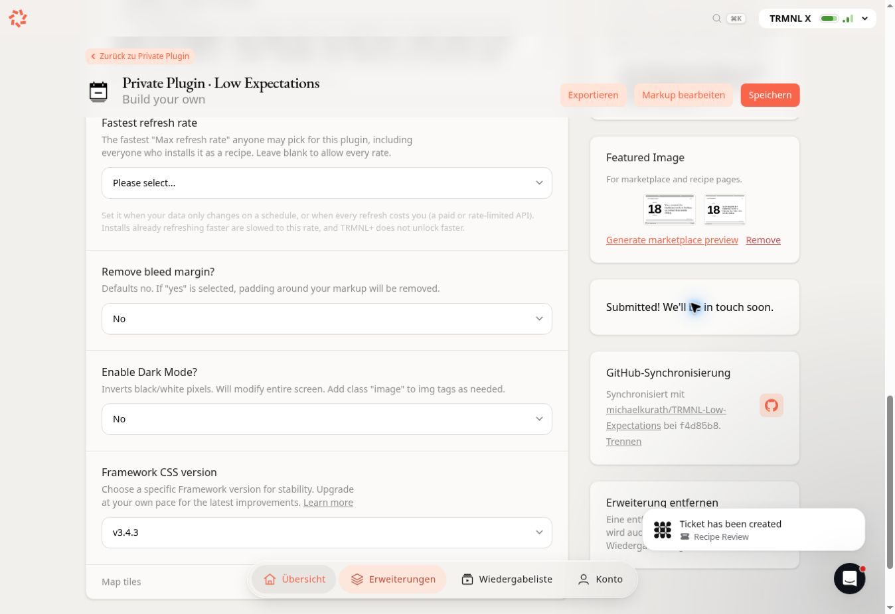

# Low Expectations: recipe publication package

**Version 0.5.1 was submitted for public review on 18 October 2026.** TRMNL displayed "Submitted! We'll be in touch soon." and created a Recipe Review ticket. Human approval is pending; the recipe is not yet published. The current version and icon are installed, and the [hosted review](validation.md#hosted-trmnl-review) passes. Physical device verification remains pending.

## Listing

| Field | Value |
| --- | --- |
| Name | Low Expectations |
| Short description | A fresh disappointment. Every day. |
| Categories | humor, calendar |
| Languages | English, Deutsch |
| Repository | https://github.com/michaelkurath/TRMNL-Low-Expectations |
| Strategy | Static |
| Reference plugin | 510794 |

The full public description is the `author_bio` field in [settings.template.yml](../src/settings.template.yml). It is included in the generated [custom fields](custom-fields.yml) and [settings](../src/settings.yml). The About text explains the daily rotation, language options, layouts, and self-contained data. It exceeds the 100-word threshold described in [TRMNL's recipe guidance](https://help.trmnl.com/en/articles/11395668-recipe-best-practices) for search-engine eligibility; that threshold does not affect TRMNL's own search.

## Artwork

| File | Purpose |
| --- | --- |
| [icon.svg](../assets/icon.svg) | Editable vector: a tear-off calendar with a minus sign |
| [icon-512.png](../assets/icon-512.png) | 512 × 512 PNG with transparency, suitable for icon upload |
| [recipe-preview.png](../assets/recipe-preview.png) | Overview artwork, 1280 × 840 |
| [OG Full, English](../assets/screenshots/og-full-en.png) | Main full-view reference |
| [OG Full, German](../assets/screenshots/og-full-de.png) | German full-view reference |
| [OG Half Horizontal, German](../assets/screenshots/og-half_horizontal-de.png) | Wide mashup reference |
| [OG Half Vertical, English](../assets/screenshots/og-half_vertical-en.png) | Tall mashup reference |
| [OG Quadrant, German](../assets/screenshots/og-quadrant-de.png) | Small mashup reference |
| [X Full, English](../assets/screenshots/x-full-en.png) | Large landscape reference |
| [X portrait Full, German](../assets/screenshots/x-portrait-full-de.png) | Large portrait reference |

The screenshots are actual local browser renders of the Liquid source with TRMNL Framework 3.4.3 and its fonts. They show 17 October 2026, while the installed calendar uses the current local date. They are not photographs of a device or captures from TRMNL's hosted renderer. Native margins and scaling explain why their bitmap sizes differ from nominal screen dimensions; see [validation](validation.md). The source SVG uses only paths and solid black/white fills, with no font or network dependency.

TRMNL accepts a custom [PNG or SVG icon](https://help.trmnl.com/en/articles/17507250-draw-a-plugin-icon-with-ai). The 512-pixel size is this project's export choice; the cited guidance does not specify a mandatory size.

## Submission and review

Already completed on 18 October 2026: import of the corrected markup, icon upload, the English/German review across 24 hosted layout/profile combinations, restoration of English, and generation of marketplace previews. These results are recorded in [hosted-review.json](hosted-review.json).

The creator then explicitly confirmed public submission under the linked [TRMNL plugin licence](https://trmnl.com/plugin-license), which applies CC BY 4.0 to the design, parsing logic, and markup, together with support and maintenance terms. The Public flow ran automated preflight checks and Chef review. After examining the findings below, the final **Submit anyway** action completed successfully.

The verified [master settings page](https://trmnl.com/plugin_settings/510794/edit) shows the submission confirmation. No approved public recipe URL has been provided yet. A GitHub push alone does not submit a recipe.

## Chef review

Chef review **1230** returned five suggestions and one nitpick, with no blocking errors. The [captured review](hosted/chef-review-2026-10-18.jpg) shows the first part of the feedback. The findings were reviewed as follows; Chef did not issue a formal pass.

| Finding | Disposition before submission |
| --- | --- |
| Verify larger date and quote sizing on X | Existing `.screen--lg` rules enlarge both. X landscape and portrait were already included in the 24 hosted checks, and the generated X image was visually reviewed. No further sizing change was made. |
| Verify the language option format and lowercase stored values | The live selector contains English → `en` and Deutsch → `de`, with `en` selected. Both languages passed hosted checks. The existing YAML list of option maps was retained. |
| Consider larger X footer and title bar text | The internal footer already has larger X rules. The title bar uses the native framework. This remains a design suggestion for human review. |
| Reduce custom CSS through framework utilities | The layouts use native `view`, `layout`, and `title_bar` elements. Custom rules support the calendar treatment and responsive typography; the tested styling was retained. |
| Check every layout and X portrait | Completed separately: all four layouts in two languages on OG, X landscape, and X portrait, with no detected overflow. |
| Shorten the About text | The 119-word About text was retained to describe the plugin and satisfy the documented search-engine eligibility threshold. |

The earlier preflight also suggested a title-bar include, a layout class, removal of a style block, and responsive utility classes. All four templates already contain native title-bar and layout elements. Responsiveness uses `.screen--lg` and `.screen--portrait` selectors. These heuristic hints were acknowledged after checking the source and hosted results.

After publication, keep the Recipe Master suitable for its public preview and install the recipe separately for personal use, as [TRMNL recommends](https://help.trmnl.com/en/articles/12772238-demo-data-for-publishing-plugins). [Recipe publishing and preview behaviour](https://help.trmnl.com/en/articles/10122094-plugin-recipes) are documented by TRMNL.

## Regenerate the assets

Use the same framework, font, and browser setup as [the layout checks](validation.md):

    LE_FRAMEWORK_DIR=/absolute/path/framework \
    LE_FONTS_DIR=/absolute/path/fonts \
    npm run recipe-assets

Set `LE_BROWSER_PATH` when using a Chromium executable outside Playwright's default installation. The command first creates fresh reference previews, then exports the icon and artwork. It preserves `docs/render-results.json`, which belongs to the full catalogue sweep. The generated [asset manifest](recipe-assets.json) records the bitmap dimensions, reference date, About word count, and pending release checks.
